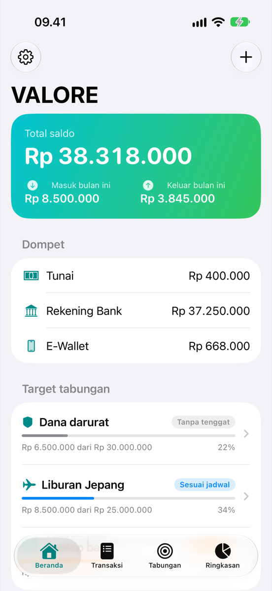
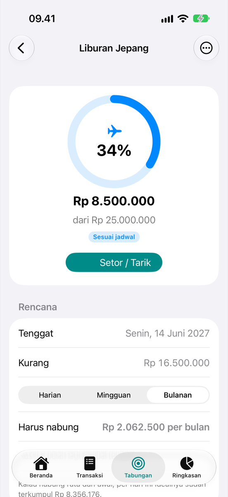
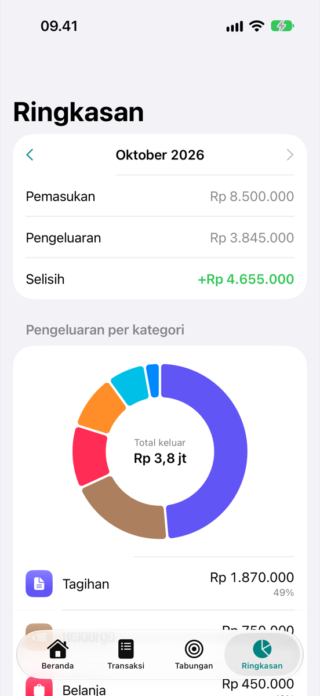
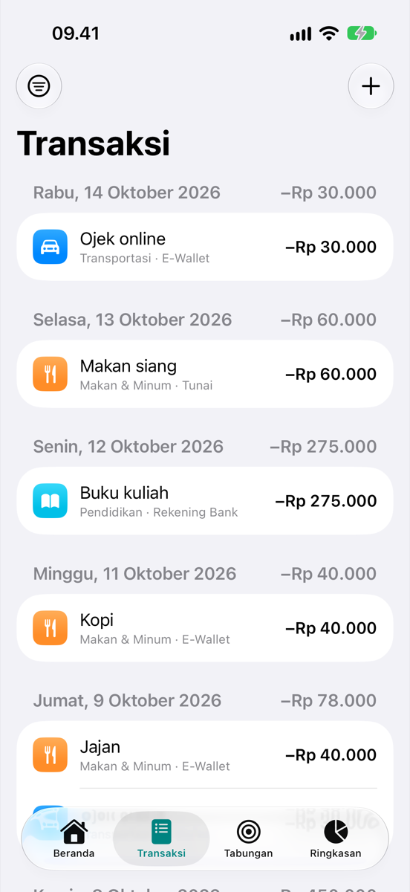
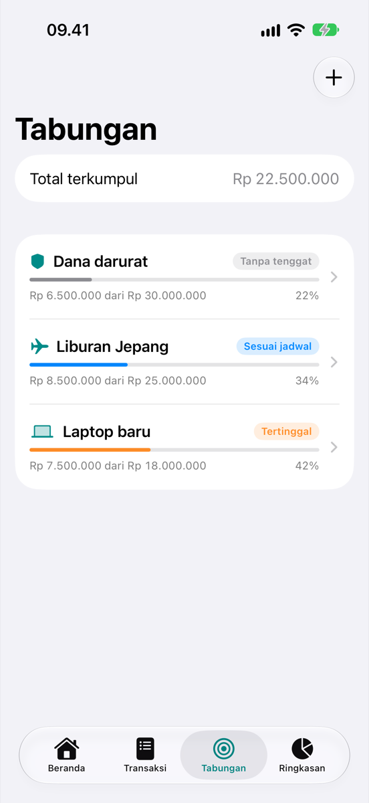
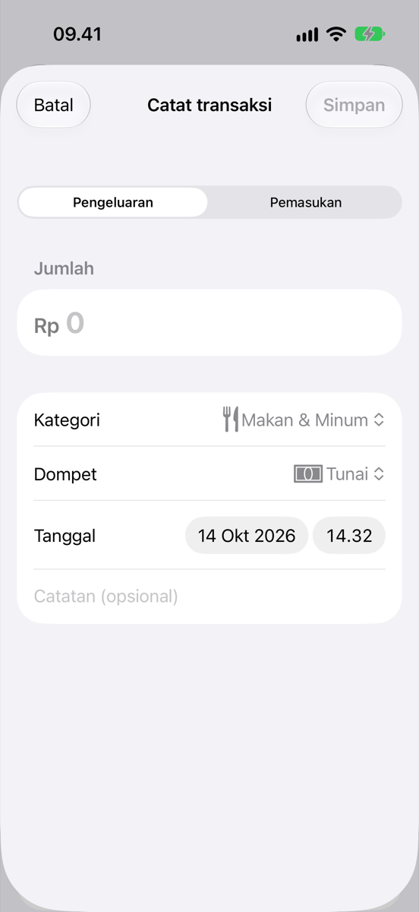

# VALORE

A personal finance tracker and savings planner for iPhone, built with SwiftUI and SwiftData.

VALORE (Italian for "value") records income and expenses across multiple wallets, summarizes where the money went each month, and turns savings goals into a concrete plan: *"save Rp 2.125.000 per month to reach this goal on time."*

The app is local-first: all data stays on the device. There is no account, server, or analytics.

<table>
  <tr>
    <td></td>
    <td></td>
    <td></td>
  </tr>
  <tr>
    <td></td>
    <td></td>
    <td></td>
  </tr>
</table>

<sub>Screenshots use generated sample data, not real finances. They are captured automatically by a UI test (see below).</sub>

## Features

- **Transactions**: record income and expenses with category, wallet, date, and note. Search, filter, and swipe to delete.
- **Wallets**: cash, bank accounts, and e-wallets, each with an opening balance and a live balance.
- **Savings goals**
  - With a deadline: calculates the amount to save per day, week, or month, and reports whether you are *ahead*, *on track*, or *behind* compared with an even schedule.
  - Without a deadline: a simulator answers *"if I save X per month, when do I reach it?"*
  - Deposits and withdrawals with full history.
- **Monthly summary**: income, expenses, and net for any month, a donut chart by category, and a 6-month income-vs-expense trend (Swift Charts).
- **Backup and restore**: export everything to a versioned JSON file (Files / iCloud Drive) and restore it on any device.
- Indonesian locale throughout: `Rp 1.500.000` formatting and Indonesian day and month names.

## Tech stack

| Area | Choice |
|---|---|
| UI | SwiftUI (iOS 17+) |
| Persistence | SwiftData |
| Charts | Swift Charts |
| Tests | Swift Testing |
| Project | [XcodeGen](https://github.com/yonaskolb/XcodeGen) (`project.yml` → `.xcodeproj`) |

## Architecture

```
Valore/
├── App/          App entry point, tab shell, first-launch setup
├── Core/         Pure Swift logic, no SwiftUI or SwiftData (fully unit-tested)
│   ├── SavingsPlan.swift    per-period requirement, pace, projection
│   ├── MonthSummary.swift   monthly totals, category breakdown, trend
│   ├── BackupFile.swift     versioned JSON backup format
│   └── Fmt.swift            Rupiah and Indonesian date formatting
├── Models/       SwiftData models (Wallet, LedgerEntry, SavingGoal, GoalDeposit)
├── Services/     Backup export and restore (SwiftData ↔ BackupFile)
├── Views/        Screens grouped by feature, plus shared components
└── Preview/      Deterministic sample data for previews and screenshots
```

Design decisions:

- **Money is stored as `Int` rupiah**, not `Double`, which avoids floating-point rounding errors. The rupiah has no practical minor unit.
- **Business logic lives in `Core/`** and works on plain value types (`EntryRecord`, `SavingsPlan`). Views and SwiftData models only adapt to it, so the calculations are tested without a database or simulator.
- **Enums are persisted as raw strings** (`kindRaw`, `categoryRaw`) with typed computed accessors, because SwiftData predicates do not reliably support enum properties.
- **Every model has a stable `uuid`**, so backups can rebuild relationships on another device, where `persistentModelID` would not survive.
- **Backups are versioned**, and the app refuses files written by a newer version instead of partially importing them.

## Getting started

Requirements: macOS with Xcode 16 or newer, and [XcodeGen](https://github.com/yonaskolb/XcodeGen) (`brew install xcodegen`).

```bash
git clone <this repo>
cd valore
xcodegen generate
open Valore.xcodeproj
```

Run the `Valore` scheme on an iPhone simulator.

To launch with sample data (in memory only, real data is untouched), enable the `-sampleData` argument in *Edit Scheme → Run → Arguments*, or run:

```bash
xcrun simctl launch booted com.ikhwansufi.valore -sampleData
```

### Running on a physical iPhone

1. Sign in with your Apple ID in *Xcode → Settings → Accounts*.
2. Create `Config/Local.xcconfig` (git-ignored) containing your team ID:
   ```
   DEVELOPMENT_TEAM = ABCDE12345
   ```
3. Run `xcodegen generate`, connect the iPhone, select it as the run destination, and press Run. Alternatively, `scripts/install-iphone.sh` builds a Release version and installs it on the first connected iPhone.
4. On the first launch, trust the developer profile on the iPhone under *Settings → General → VPN & Device Management*.

With a free Apple ID, the app expires after 7 days and must be re-installed from Xcode. Your data is kept as long as the app is not deleted.

## Tests

```bash
xcodebuild test -scheme Valore -destination 'platform=iOS Simulator,name=iPhone 17'
```

Or press ⌘U in Xcode. The tests cover the savings planner (rounding, partial months, overdue goals, pace), monthly aggregation and month boundaries, Rupiah formatting and parsing, and the backup round trip and version checks.

The `Screenshots` scheme runs a UI test that launches the app with sample data, walks through every main screen, and attaches a screenshot of each to the test result:

```bash
xcodebuild test -scheme Screenshots -destination 'platform=iOS Simulator,name=iPhone 17' -resultBundlePath shots.xcresult
xcrun xcresulttool export attachments --path shots.xcresult --output-path screenshots
```

## Roadmap

- [ ] Monthly budgets per category with alerts
- [ ] Transfers between wallets
- [ ] Link goal deposits to a source wallet
- [ ] Recurring transactions (salary, rent, subscriptions)
- [ ] Home Screen widget for balance and goal progress
- [ ] Face ID lock

## Author

M. Ikhwan Sufi. Built as a personal project and portfolio piece.
